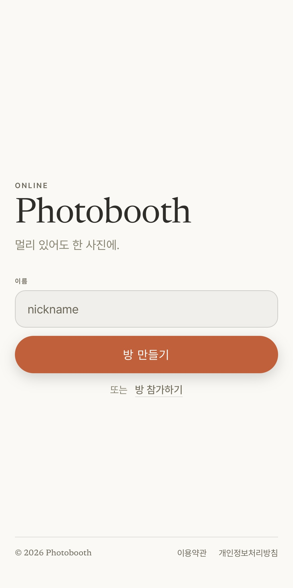
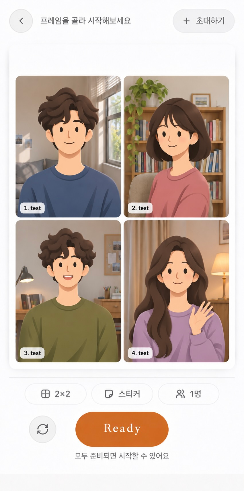

# Online Photobooth

여러 사람이 함께 사진을 찍고 프레임·필터·스티커로 꾸밀 수 있도록 개발한 온라인 포토부스 프로젝트입니다.

**방 생성·참가 → 준비 → 카운트다운 → 촬영 → 결과 확인·다운로드**

이 저장소는 연구실 지원을 위한 포트폴리오입니다. 프로젝트의 사용자 경험, 개발 기여와 결과 화면을 소개합니다.

## 화면 미리보기

| 시작 화면 | 촬영 화면 |
| :---: | :---: |
|  |  |

촬영 화면의 인물은 AI로 제작한 예시 이미지입니다.

## 구현한 사용자 경험

- 초대받은 참가자들이 함께 준비하고 촬영하는 흐름
- 참가자 영상 미리보기와 카메라 조작
- 프레임·필터·스티커를 이용한 사진 꾸미기
- 촬영 결과 확인과 이미지 다운로드
- 작은 상태 변경에도 영상 화면을 유지하는 부분 갱신

## 담당한 개발

사용자 화면뿐 아니라 서비스 전반의 개발을 담당했습니다. 여러 참가자의 상호작용과 촬영 흐름을 맞추고, 브라우저 카메라·실시간 영상·이미지 처리를 하나의 사용자 경험으로 연결했습니다.

화면, 사용자 입력, 상태와 통신 역할을 나누어 코드를 구성했고, 기기별 영상 동작과 화면 갱신 문제를 반복적으로 확인하며 개선했습니다.

주요 활용 기술은 JavaScript, HTML/CSS, Node.js, Express, Socket.io, WebRTC와 Canvas/WebGL입니다. 기술 이름은 개발 경험을 설명하기 위한 것이며 운영 구성이나 접속 정보를 나타내지 않습니다.

## 기여와 개발 과정

- 본인(UpDownGithub): 서비스 전반과 사용자 화면 개발
- 동료 1명: 관리자 화면 개발
- AI 도구: 설계, 코드 작성과 디버깅에 활용

자세한 역할은 [개발 기여 문서](docs/CONTRIBUTIONS.md)에 정리했습니다.

## 코드 살펴보기

| 내용 | 대표 파일 |
| --- | --- |
| 시작 화면 | [landing.view.js](frontend/src/pages/landing.view.js) |
| 촬영 화면 | [room.view.js](frontend/src/pages/room.view.js) |
| 결과 화면 | [review.view.js](frontend/src/pages/review.view.js) |
| 부분 갱신 | [partial-updates.js](frontend/src/pages/partial-updates.js) |
| 스티커 조작 | [sticker.interactions.js](frontend/src/pages/sticker.interactions.js) |
| 상태·레이아웃 | [상태 관리](frontend/src/store/room.store.js), [좌표 계산](frontend/src/pages/layouts.js) |
| UI·스타일 | [UI 컴포넌트](frontend/src/ui), [CSS](frontend/styles) |
| 서버 처리 예시 | [컨트롤러](backend/modules/frames/frame.controller.cjs), [서비스](backend/modules/frames/frame.service.cjs) |
| 서버 계산 모듈 | [레이아웃](backend/modules/frames/layouts.cjs), [필터](backend/modules/filters/filters.cjs) |

파일별 역할과 공개용 변경 사항은 [코드 안내](docs/CODE_GUIDE.md)에 정리했습니다.

## 공개 범위

이 저장소에는 실제 프로젝트에서 선별한 프런트엔드 코드와 서버 예시를 담았습니다. 독립적으로 읽을 수 있도록 일부 파일을 발췌하거나 의존성을 바꿨으며, 변경한 부분은 코드 안내에서 구분합니다. 전체 서비스를 실행하는 배포본은 아닙니다.
